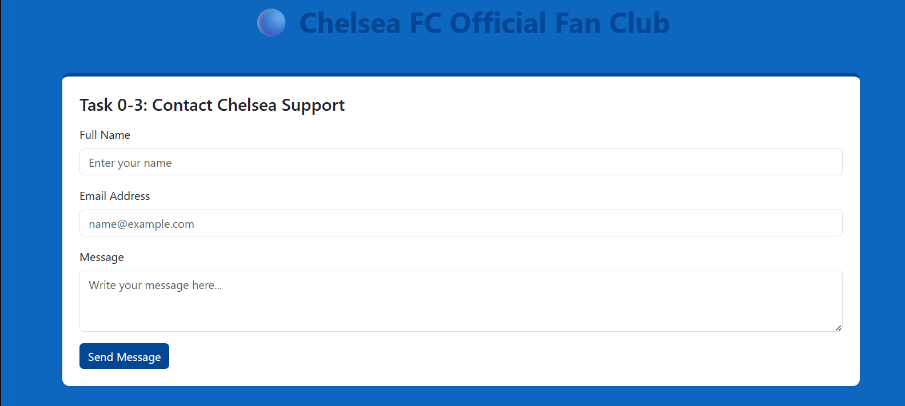
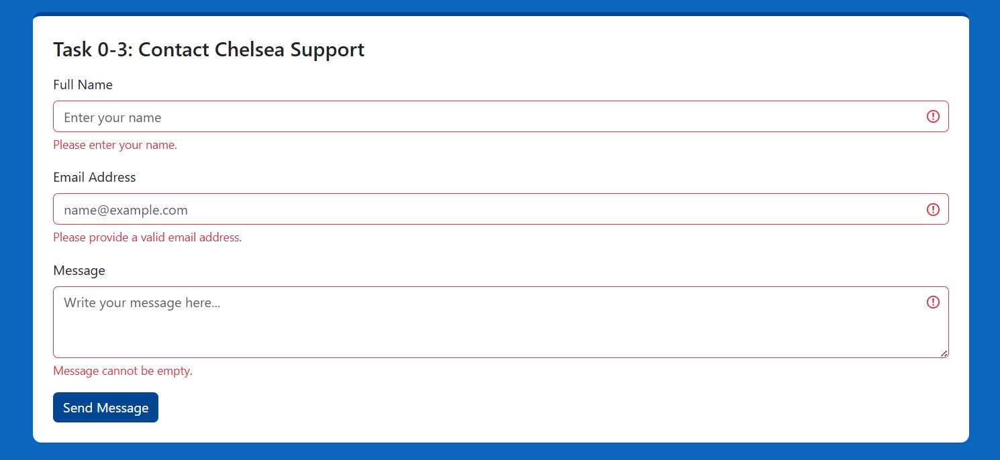
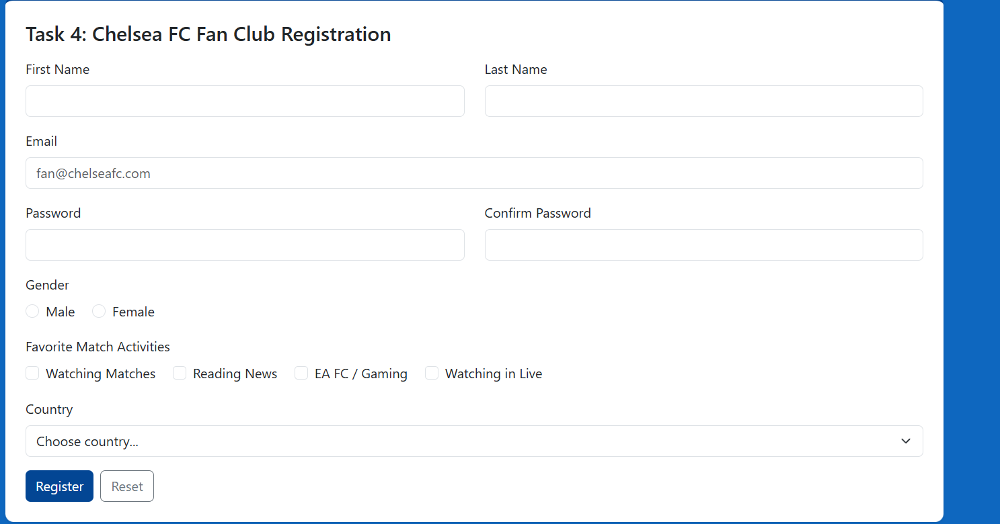

# Assignment #4: Forms and Validation

**Name:** Nurkhan Karashev  
**Group:** SE-2540  
**Topic:** Chelsea FC Fan Portal

## About the Work

In this assignment, I created HTML forms styled with Bootstrap 5 and added HTML5 and Bootstrap validation.

## Screenshots

### Task 0-2: Contact Form:I created a simple contact form with name, email, and message fields using HTML5 and Bootstrap. Then, I added validation and feedback styles to check the entered data.

### Task 3: Validation State

### Task 4: Registration Form:I created a fan registration form with name, email, password, gender, hobbies, country, and submit buttons using Bootstrap layout and validation.

## Work Process Summary

First, I created the index.html file, connected Bootstrap 5 via CDN, and added a custom style.css file with the Chelsea FC theme.

Next, I designed the contact and registration forms using Bootstrap layout classes and required fields.

Finally, I added HTML5 validation attributes and Bootstrap scripts to test error messages with invalid data.
